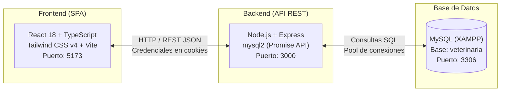
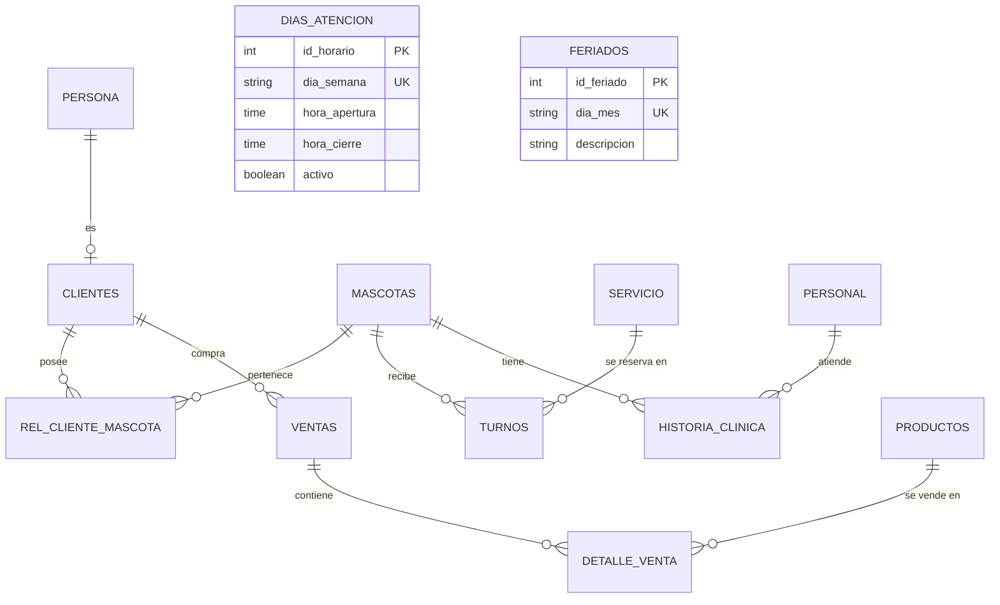

# Contexto de la Aplicación — Mundo Peludo

Documento maestro de referencia sobre la arquitectura, modelo de datos, módulos funcionales y guía operativa del proyecto **Mundo Peludo**.

---

## 1. Resumen y Propósito del Proyecto

* **Nombre del Proyecto:** Mundo Peludo
* **Tipo de Aplicación:** Sistema web integral de gestión para clínica veterinaria y tienda de mascotas (*Pet Shop*).
* **Propósito y Enfoque:** Proyecto de práctica y formación en desarrollo web full-stack. La arquitectura prioriza la claridad pedagógica, la mantenibilidad y la ausencia de sobre-ingeniería (*keep it simple*).
* **Rama de Trabajo Actual:** `turnos_dias`
* **Directiva de Control de Versiones:** Los cambios de código se implementan y se dejan en el área de preparación (*staged* o modificados) para revisión del usuario; **no se realizan commits sin confirmación explícita previa**.

---

## 2. Arquitectura y Stack Tecnológico

El sistema sigue una arquitectura cliente-servidor desacoplada basada en una API REST:



### Tecnologías Frontend (`MundoPeludoF`)
* **Framework:** React 18 con TypeScript.
* **Empaquetador y Servidor de Desarrollo:** Vite 6.
* **Estilos:** Tailwind CSS v4, componentes estilizados basados en Radix UI / Shadcn.
* **Iconografía:** Lucide React.
* **Manejo de Estado / Sesión:** Context API de React (`AuthContext.tsx`) y Custom Hooks (`useTurnos`, `useCatalogos`, `useProductos`).

### Tecnologías Backend (`MundoPeludoB`)
* **Entorno:** Node.js (64-bit recomendado para compatibilidad con compilaciones nativas).
* **Servidor HTTP:** Express 4.
* **Conexión a BD:** `mysql2` con soporte para promesas (`db.promise()`) y transacciones serializadas con bloqueos (`FOR UPDATE`).
* **Seguridad y Sesiones:** Criptografía nativa de Node (`crypto`), HMAC-SHA256 para firma de cookies de sesión (`mp_session`), encriptación de contraseñas con `bcryptjs`.
* **CORS:** Configurado para admitir `http://localhost:5173` con soporte de credenciales.

### Base de Datos
* **Motor:** MySQL 5.7+ / MariaDB (típicamente provisto vía XAMPP en `localhost:3306`).
* **Nombre de Base de Datos:** `veterinaria`.
* **Usuario por defecto:** `root` (sin contraseña).

---

## 3. Estructura del Repositorio

```text
MundoPeludo/
├── MundoPeludoF/                      # Frontend (Vite + React + TS)
│   ├── src/
│   │   ├── app/
│   │   │   ├── components/            # Vistas y componentes funcionales
│   │   │   │   ├── Account.tsx        # Perfil y datos del cliente
│   │   │   │   ├── AdminPanel.tsx     # Panel general del administrador
│   │   │   │   ├── Appointments.tsx   # Reserva de turnos online
│   │   │   │   ├── configuracion.tsx  # Parámetros y horarios de atención
│   │   │   │   ├── Dashboard.tsx      # Métricas e inicio del sistema
│   │   │   │   ├── Home.tsx           # Portada pública y servicios
│   │   │   │   ├── Layout.tsx         # Encabezado, navegación y pie
│   │   │   │   ├── Register.tsx       # Alta de nuevos usuarios
│   │   │   │   ├── Shop.tsx           # Tienda de productos (Pet Shop)
│   │   │   │   ├── VentasAdmin.tsx    # Gestión de pedidos y despachos
│   │   │   │   └── VetPanel.tsx       # Panel veterinario / Historias clínicas
│   │   │   ├── context/
│   │   │   │   └── AuthContext.tsx    # Proveedor de sesión y autenticación
│   │   │   ├── hooks/                 # Lógica desacoplada y llamadas API
│   │   │   │   ├── useCatalogos.ts    # Servicios, feriados, especies, razas
│   │   │   │   ├── useProductos.ts    # Productos del pet shop
│   │   │   │   └── useTurnos.ts       # Gestión de turnos y disponibilidad
│   │   ├── service/
│   │   │   └── api.ts                 # Cliente HTTP con endpoints del backend
│   │   └── styles/                    # Configuración de estilos y temas
│   ├── package.json
│   └── vite.config.ts
│
├── MundoPeludoB/                      # Backend (Node.js + Express + MySQL)
│   ├── dias_atencion.sql              # Script DDL/DML para tabla dias_atencion
│   ├── server.js                      # Servidor principal y rutas REST
│   └── package.json
│
├── docs/                              # Documentación técnica del proyecto
│   ├── especificacion-turnos-configurables.md
│   ├── plan-implementacion-turnos.md
│   ├── lista-tareas-turnos.md
│   ├── propuesta-disponibilidad-turnos.md
│   └── contexto-aplicacion.md         # (Este documento)
│
├── img/                               # Recursos estáticos e imágenes del negocio
└── CONTEXT.md                         # Acceso directo al contexto del proyecto
```

---

## 4. Módulos Funcionales

### 4.1. Sistema de Turnos y Disponibilidad Horaria

Es el núcleo operativo de la clínica. Permite a los clientes solicitar turnos y a los administradores coordinar la agenda diaria.

* **Días y Horarios Parametrizables (`dias_atencion`):**
  * Cada día de la semana (Lunes a Domingo) tiene configurado:
    * Si la veterinaria atiende o permanece cerrada (`activo = 1 / 0`).
    * Hora de apertura (`hora_apertura`, ej. `09:00:00`).
    * Hora de cierre (`hora_cierre`, ej. `20:00:00` de Lunes a Viernes, `13:00:00` los Sábados).
  * Los administradores pueden modificar estos valores interactivamente desde la pantalla de Configuración.
* **Cálculo Dinámico de Slots Libres (`GET /api/turnos/disponibles`):**
  * La clínica opera con turnos en intervalos de **30 minutos** (09:00, 09:30, 10:00, etc.).
  * Cada servicio tiene una duración fija (`duracion_minutos`, ej. Consulta: 30 min, Baño: 60 min).
  * Un turno no puede exceder el horario de cierre del día.
* **Agenda Unificada y Detección de Colisiones:**
  * Toda reserva activa (`estado = 'activo'`) ocupa el espacio físico y profesional de la clínica.
  * Dos turnos colisionan si sus intervalos de tiempo se solapan:
    $$\text{colisión} \iff (\text{inicio}_1 < \text{fin}_2) \land (\text{inicio}_2 < \text{fin}_1)$$
  * Si un horario ya está reservado o genera colisión con la duración del servicio seleccionado, **desaparece de las opciones a elegir** para evitar errores del usuario.
* **Feriados Fijos:** Se bloquean automáticamente las reservas en fechas registradas en la tabla `feriados` (formato `DD-MM`).
* **Acciones:**
  * Crear turno (`POST /api/turnos`).
  * Reprogramar turno (`PATCH /api/turnos/:id/reprogramar`).
  * Cancelar turno (`PATCH /api/turnos/:id/cancelar`).

### 4.2. Historias Clínicas y Atención Veterinaria (`VetPanel`)

* Registro de la evolución médica de cada mascota.
* Atributos gestionados: fecha/hora de atención, peso, temperatura, motivo de consulta, diagnóstico, tratamiento indicado, vacunas aplicadas y desparasitaciones.
* Endpoints: `GET /api/historias`, `POST /api/historias`, `PUT /api/historias/:id`.

### 4.3. Clientes y Mascotas

* **Clientes:** Entidad física (`persona`) vinculada con cuenta de cliente (`clientes`).
* **Mascotas:** Registro con nombre, especie (perro, gato, ave, etc.), raza, sexo, fecha de nacimiento y titular responsable a través de `rel_cliente_mascota`.
* Endpoints: `GET /api/mascotas`, `GET /api/mascotas/cliente/:clienteId`, `POST /api/mascotas/agregar`.

### 4.4. Pet Shop y Ventas (`Shop`, `VentasAdmin`)

* Catálogo de productos con título, descripción, precio, categoría, stock e imágenes almacenadas en base de datos.
* Carrito de compras con persistencia local y registro de órdenes de venta (`ventas` y `detalle_venta`).
* Gestión de despacho: el administrador puede marcar órdenes como entregadas (`PATCH /api/ventas/:id/entrega`).

### 4.5. Configuración General (`configuracion`)

* Almacena datos institucionales de la veterinaria: Razón Social, CUIT, Dirección, Teléfono, Correo Electrónico.
* Interfaz unificada que combina los datos generales con la grilla de días y horarios de atención.

---

## 5. Modelo de Base de Datos (`veterinaria`)

A continuación se ilustra la relación de las principales entidades del sistema:



### Detalle de Tablas Críticas

| Tabla | Columnas Clave | Propósito |
| :--- | :--- | :--- |
| `dias_atencion` | `id_horario`, `dia_semana`, `hora_apertura`, `hora_cierre`, `activo` | Días habilitados y franjas horarias por día de la semana. |
| `turnos` | `id_turno`, `fecha_hora`, `id_mascota`, `id_servicio`, `motivo`, `estado` | Reservas de atención (`activo` o `cancelado`). |
| `servicio` | `id_servicio`, `descripcion`, `duracion_minutos`, `precio` | Catálogo de prestaciones y su tiempo de ocupación. |
| `feriados` | `id_feriado`, `dia_mes` (`DD-MM`), `descripcion` | Días no laborables donde se impide la agenda. |
| `mascotas` | `id_mascota`, `nombre`, `id_especie`, `id_raza`, `fecha_nacimiento`, `sexo` | Ficha técnica de cada animal. |
| `historia_clinica` | `id_historia`, `id_mascota`, `id_personal`, `fecha_atencion`, `diagnostico`, `tratamiento` | Expediente médico del paciente. |
| `productos` | `id_producto`, `nombre`, `descripcion`, `precio`, `stock`, `imagen` | Artículos a la venta en el Pet Shop. |
| `ventas` | `id_venta`, `id_cliente`, `fecha_venta`, `total`, `estado_entrega` | Comprobantes y órdenes de compra. |

---

## 6. Endpoints Principales de la API REST

| Método | Endpoint | Descripción |
| :--- | :--- | :--- |
| `GET` | `/api/dias-atencion` | Obtiene la configuración semanal de días y horarios. |
| `PUT` | `/api/dias-atencion` | Actualiza la configuración semanal desde el panel admin. |
| `GET` | `/api/turnos/disponibles` | Devuelve los horarios libres para una fecha y servicio (`?fecha=YYYY-MM-DD&id_servicio=X`). |
| `GET` | `/api/turnos` | Lista los turnos activos (con filtro opcional por fecha). |
| `POST` | `/api/turnos` | Registra una nueva reserva validando solapamientos y horario de atención. |
| `PATCH` | `/api/turnos/:id/reprogramar` | Modifica la fecha/hora de un turno existente validando disponibilidad. |
| `PATCH` | `/api/turnos/:id/cancelar` | Cambia el estado del turno a `cancelado`. |
| `GET` | `/api/catalogos/:tipo` | Catálogos del sistema (`servicios`, `feriados`, `especies`, `razas`). |
| `GET` | `/api/configuracion` | Obtiene los datos generales de la clínica. |
| `GET` | `/api/historias` | Lista historias clínicas registradas. |
| `POST` | `/api/historias` | Da de alta una nueva atención clínica. |
| `GET` | `/api/productos` | Obtiene los artículos del catálogo de venta. |
| `POST` | `/api/ventas` | Registra una compra del cliente y descuenta stock. |

---

## 7. Guía de Puesta en Marcha (Entorno Local)

### Requisitos Previos
1. **Node.js:** Versión 20+ de 64-bit (`x64`).
2. **XAMPP / MySQL:** Servicio MySQL iniciado en el puerto `3306`.
3. **Base de Datos:** Base creada con nombre `veterinaria`.

### 1. Inicialización de la Base de Datos
Si se requiere configurar los días y horarios por primera vez:
```sql
-- Ejecutar en phpMyAdmin o consola MySQL sobre la base `veterinaria`
SOURCE MundoPeludoB/dias_atencion.sql;
```

### 2. Ejecución del Backend
Abrir una terminal en la carpeta del backend:
```powershell
cd MundoPeludoB
node server.js
```
* Servidor escuchando en: `http://localhost:3000`

### 3. Ejecución del Frontend
Abrir una segunda terminal en la carpeta del frontend:
```powershell
cd MundoPeludoF
npm run dev
```
* Aplicación disponible en: `http://localhost:5173`

---

## 8. Buenas Prácticas y Decisiones de Diseño

1. **Evitar sobre-ingeniería:** Mantener funciones directas, comprensibles y sin dependencias superfluas.
2. **Validación doble (Frontend y Backend):**
   * El frontend mejora la experiencia de usuario omitiendo los horarios ocupados.
   * El backend actúa como garante final usando transacciones ACID con bloqueos serializados (`FOR UPDATE`) para evitar reservas concurrentes sobre el mismo horario.
3. **Consistencia de fecha y hora:** Las fechas se manejan siempre en formato ISO estándar (`YYYY-MM-DD`) y las horas en formato 24h (`HH:mm`).
4. **Respeto a las directivas de Git:** La rama activa de trabajo es `turnos_dias`. Cada grupo de cambios debe quedar en el área de preparación (*staged*) para revisión antes de consolidar cualquier commit.

