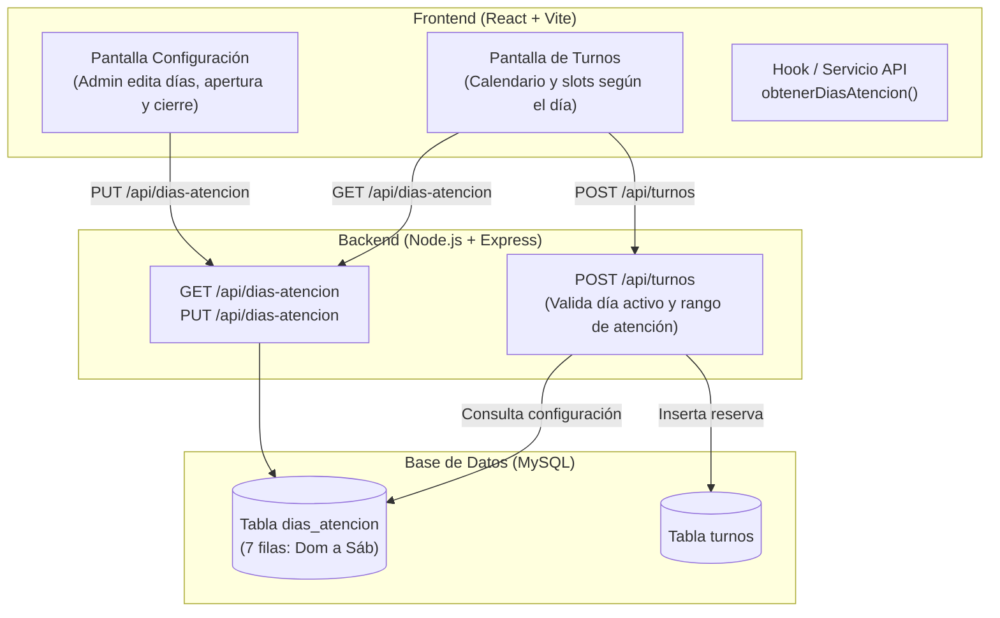
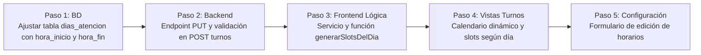

# Especificación Funcional y Técnica: Sistema de Turnos Configurables por Día

**Proyecto:** Mundo Peludo (Veterinaria)  
**Fecha:** 25 de Octubre de 2026 (Actualizado)  
**Estado:** Propuesta / En revisión  
**Ubicación:** `docs/especificacion-turnos-configurables.md`  

---

## 1. Resumen Ejecutivo y Objetivo

El sistema actual de reserva de turnos posee horarios fijos codificados en el frontend (`09:00` a `18:30` cada 30 minutos) que se aplican de manera idéntica a cualquier día habilitado, y deshabilita los domingos mediante una regla estática en código (`diaSemana === 0`).

**Objetivo:**  
Permitir que **cada día de la semana cuente con su propio horario de atención y generación de turnos**, adaptado al esquema real de la veterinaria:
- **Lunes a Viernes:** Horario de corrido de **09:00 a 20:00**.
- **Sábados:** Horario continuo matutino de **09:00 a 13:00**.
- **Domingos:** Sin atención por defecto (`activo = 0`).
- **Parametrizable:** Tanto los días activos como sus horas de inicio y fin deben poder configurarse desde la interfaz administrativa (pantalla de Configuración) y persistirse en la base de datos, sin tocar el código fuente.

> [!NOTE]  
> **Criterio de Diseño (Sin sobre-ingeniería):**  
> Al tratarse de horario de corrido, la estructura es aún más sencilla y directa: cada día posee únicamente una `hora_inicio` y una `hora_fin`. No se requiere complejidad de múltiples turnos partidos ni reglas abstractas. Una sola tabla relacional en MySQL, endpoints REST convencionales en Express, y componentes claros en React con TypeScript.

---

## 2. Diagnóstico del Estado Actual

### 2.1 Base de Datos (MySQL)
- **Tabla `turnos`:** Registra los turnos reservados (`id_turno`, `fecha_hora`, `id_mascota`, `id_servicio`, `motivo`, `estado`).
- **Tabla `feriados`:** Registra feriados fijos (`dia_mes`, `nombre`) que bloquean la reserva.
- **Tabla `servicio`:** Almacena servicios y su duración (`duracion_minutos`).
- **Tabla `dias_atencion`:** Se consulta en `server.js` (`SELECT * FROM dias_atencion`), pero no está integrada en la lógica de validación ni consumida activamente por la interfaz.

### 2.2 Backend (`MundoPeludoB/server.js`)
- **Endpoint `GET /api/turnos`:** Devuelve únicamente los turnos activos guardados.
- **Endpoint `POST /api/turnos`:**
  - Valida que la fecha no sea feriado (`SELECT id_feriado FROM feriados WHERE dia_mes = ?`).
  - Valida solapamiento de horarios entre turnos activos considerando la duración del servicio.
  - **Falta:** No valida si el día de la semana tiene atención habilitada ni si la hora solicitada está comprendida entre la `hora_inicio` y `hora_fin` permitida para ese día específico.
- **Endpoint `GET /api/dias-atencion`:** Devuelve los registros de la tabla, pero no existen endpoints `PUT` para que el administrador actualice los horarios.

### 2.3 Frontend (`MundoPeludoF`)
- **`Appointments.tsx` (Turnos Cliente):**
  - Horarios fijos generados mediante un arreglo estático en la función `getTimeSlots()`:
    ```ts
    const slots = [
      "09:00", "09:30", "10:00", "10:30", "11:00", "11:30",
      "12:00", "12:30", "14:00", "14:30", "15:00", "15:30",
      "16:00", "16:30", "17:00", "17:30", "18:00", "18:30"
    ];
    ```
  - La exclusión de los domingos está fijada directamente en código:
    ```ts
    const esDomingo = diaSemana === 0;
    return d >= today && d <= twoMonthsLater && !esFeriado(d) && !esDomingo;
    ```
- **`AdminPanel.tsx` (Turnos Administrador):**
  - Replica el mismo arreglo estático de horarios y no valida la restricción de domingos.
- **`configuracion.tsx` (`PantallaConfiguracion`):**
  - Actualmente es un componente visual estático (placeholder con texto fijo sobre datos de contacto) sin opciones para editar días ni horarios de atención.

---

## 3. Arquitectura y Solución Propuesta



---

## 4. Detalle de Especificación por Componente

### 4.1 Base de Datos (MySQL)

Estructura directa y simplificada para la tabla `dias_atencion`, donde cada fila representa un día de la semana (0 = Domingo a 6 = Sábado):

```sql
CREATE TABLE IF NOT EXISTS dias_atencion (
  id INT AUTO_INCREMENT PRIMARY KEY,
  numero_dia TINYINT NOT NULL UNIQUE COMMENT '0: Domingo, 1: Lunes, ..., 6: Sábado (formato JS getDay())',
  nombre_dia VARCHAR(15) NOT NULL COMMENT 'Lunes, Martes, etc.',
  activo TINYINT(1) NOT NULL DEFAULT 1 COMMENT '1 = Atiende turnos, 0 = Cerrado',
  hora_inicio TIME NULL COMMENT 'Apertura de corrido, ej: 09:00:00',
  hora_fin TIME NULL COMMENT 'Cierre de corrido, ej: 20:00:00 o 13:00:00',
  intervalo_minutos INT NOT NULL DEFAULT 30 COMMENT 'Duración base de cada bloque de turno'
);
```

#### Datos Semilla (Defaults exactos según el requerimiento):
| numero_dia | nombre_dia | activo | hora_inicio | hora_fin | intervalo_minutos | Descripción |
|:---:|:---|:---:|:---:|:---:|:---:|:---|
| **0** | Domingo | **0 (Inactivo)** | NULL | NULL | 30 | Cerrado por defecto (configurable) |
| **1** | Lunes | **1 (Activo)** | 09:00:00 | 20:00:00 | 30 | Horario de corrido |
| **2** | Martes | **1 (Activo)** | 09:00:00 | 20:00:00 | 30 | Horario de corrido |
| **3** | Miércoles | **1 (Activo)** | 09:00:00 | 20:00:00 | 30 | Horario de corrido |
| **4** | Jueves | **1 (Activo)** | 09:00:00 | 20:00:00 | 30 | Horario de corrido |
| **5** | Viernes | **1 (Activo)** | 09:00:00 | 20:00:00 | 30 | Horario de corrido |
| **6** | Sábado | **1 (Activo)** | 09:00:00 | 13:00:00 | 30 | Mañana de corrido |

---

### 4.2 Backend (`MundoPeludoB/server.js`)

#### A. Consulta de configuración
- **`GET /api/dias-atencion`**
  - Devuelve los 7 registros ordenados por `numero_dia ASC`.
  - Respuesta HTTP 200 con el arreglo JSON.

#### B. Actualización de configuración (Administración)
- **`PUT /api/dias-atencion`**
  - Recibe el arreglo actualizado de los días:
    ```json
    [
      { "numero_dia": 0, "activo": 0, "hora_inicio": null, "hora_fin": null, "intervalo_minutos": 30 },
      { "numero_dia": 1, "activo": 1, "hora_inicio": "09:00", "hora_fin": "20:00", "intervalo_minutos": 30 },
      ...
      { "numero_dia": 6, "activo": 1, "hora_inicio": "09:00", "hora_fin": "13:00", "intervalo_minutos": 30 }
    ]
    ```
  - Actualiza la tabla en MySQL y devuelve `{ ok: true }`.

#### C. Validación robusta en `POST /api/turnos` y reprogramación
Al recibir `{ fecha: "YYYY-MM-DD", hora: "HH:mm" }`:
1. Obtener el día de la semana (`numero_dia = new Date(fecha + 'T00:00:00').getDay()`).
2. Consultar `dias_atencion WHERE numero_dia = ?`:
   - Si `activo == 0`: Rechazar con HTTP 400 (`error: "La veterinaria no atiende en el día seleccionado"`).
   - Validar que `hora >= hora_inicio` y que `hora + duracion_servicio <= hora_fin`.  
     *Ejemplo:* Si el sábado cierra a las 13:00 y un servicio dura 30 minutos, el último turno permitido es a las 12:30. Si intentan reservar a las 12:45 o 13:00, se rechaza.
   - Si está fuera de horario: Rechazar con HTTP 400 (`error: "El horario seleccionado está fuera del horario de atención de este día"`).

---

### 4.3 Frontend (`MundoPeludoF`)

#### A. Generador dinámico de horarios (`useTurnos.ts`)
Función utilitaria limpia que calcula los turnos de cualquier día:
```ts
export function generarSlotsDelDia(
  configDia: DiaAtencion,
  duracionServicio: number = 30
): string[] {
  if (!configDia.activo || !configDia.hora_inicio || !configDia.hora_fin) return [];

  const slots: string[] = [];
  const [hIni, mIni] = configDia.hora_inicio.split(':').map(Number);
  const [hFin, mFin] = configDia.hora_fin.split(':').map(Number);
  const inicioMinutos = hIni * 60 + mIni;
  const finMinutos = hFin * 60 + mFin;
  const paso = configDia.intervalo_minutos || 30;

  for (let min = inicioMinutos; min + duracionServicio <= finMinutos; min += paso) {
    const hh = String(Math.floor(min / 60)).padStart(2, '0');
    const mm = String(min % 60).padStart(2, '0');
    slots.push(`${hh}:${mm}`);
  }

  return slots;
}
```
*Resultado automático:*
- **Lunes a Viernes (09:00 a 20:00):** Produce `09:00`, `09:30`, `10:00`, ..., `19:30`.
- **Sábado (09:00 a 13:00):** Produce `09:00`, `09:30`, `10:00`, ..., `12:30`.
- **Domingo (inactivo):** Produce `[]` (arreglo vacío).

#### B. Calendario y Reserva (`Appointments.tsx` y `AdminPanel.tsx`)
1. Cargar la configuración de días con `obtenerDiasAtencion()` desde la API.
2. **Bloqueo dinámico del calendario:**
   ```ts
   const isDateAvailable = (day: number) => {
     const d = new Date(currentMonth.getFullYear(), currentMonth.getMonth(), day);
     const numDia = d.getDay();
     const configDia = diasAtencion.find(da => da.numero_dia === numDia);
     const diaHabilitado = configDia ? Boolean(configDia.activo) : false;

     return d >= today && d <= twoMonthsLater && !esFeriado(d) && diaHabilitado;
   };
   ```
   *El domingo queda deshabilitado dinámicamente porque en la BD tiene `activo = 0`. Si el administrador lo habilita en la configuración, el domingo se activará en el calendario sin tocar código.*
3. **Renderizado de horarios:**
   Al hacer clic en una fecha:
   - Se obtienen los slots del día mediante `generarSlotsDelDia(configDia, duracion)`.
   - Se comprueba la disponibilidad de cada slot con `slotAvailable(...)` para pintarlos en verde/gris.

#### C. Pantalla de Configuración (`configuracion.tsx`)
Diseño de interfaz simple y práctico para el usuario administrador:
- Una tabla con los 7 días de la semana.
- Para cada día:
  - Checkbox o Switch: **Atiende (Sí / No)**.
  - Input `time` para **Hora de apertura** (ej. 09:00).
  - Input `time` para **Hora de cierre** (ej. 20:00 en días hábiles, 13:00 los sábados).
  - Input numérico para **Intervalo (minutos)** (por defecto 30).
- Botón **"Guardar Horarios de Atención"** que envía el `PUT /api/dias-atencion`.

---

## 5. Plan de Implementación Paso a Paso (Para cuando decidas ejecutar)



1. **Paso 1 - Base de Datos:**
   Verificar y actualizar la tabla `dias_atencion` con las columnas `hora_inicio`, `hora_fin`, `activo`, `intervalo_minutos` e insertar la configuración requerida (Lunes a Viernes 09:00 a 20:00, Sábados 09:00 a 13:00, Domingos inactivos).
2. **Paso 2 - Backend (`server.js`):**
   - Implementar `PUT /api/dias-atencion` para actualizar los horarios desde la administración.
   - Añadir validación en `POST /api/turnos` y `PATCH /api/turnos/:id/reprogramar` para verificar día abierto y rango horario.
3. **Paso 3 - Funciones utilitarias Frontend (`api.ts` y `useTurnos.ts`):**
   - Función `actualizarDiasAtencion(datos)` en `src/service/api.ts`.
   - Función `generarSlotsDelDia(...)` en `src/app/hooks/useTurnos.ts`.
4. **Paso 4 - Pantallas de Turnos (`Appointments.tsx` y `AdminPanel.tsx`):**
   - Deshabilitar días según `activo` de la BD.
   - Generar y renderizar los slots específicos del día seleccionado.
5. **Paso 5 - Pantalla de Configuración (`configuracion.tsx`):**
   - Construir el formulario interactivo para que el usuario pueda editar y guardar los horarios de cualquier día.

---

## 6. Criterios de Aceptación y Pruebas

- [ ] **Lunes a Viernes:** Al seleccionar cualquier día entre lunes y viernes, se listan turnos de corrido desde las 09:00 hasta las 19:30 (asumiendo turnos de 30 min hasta las 20:00).
- [ ] **Sábado:** Al seleccionar un sábado, solo se listan turnos desde las 09:00 hasta las 12:30 (cierre a las 13:00).
- [ ] **Domingo:** Aparece deshabilitado / no seleccionable en el calendario.
- [ ] **Parametrizable:** Si desde la pantalla de Configuración se cambia el cierre del viernes a las 18:00 o se activa el domingo de 10:00 a 14:00, el calendario y los horarios reflejan el cambio inmediatamente.
- [ ] **Validación en Backend:** Peticiones HTTP directas para días inactivos o fuera del rango horario son rechazadas con error HTTP 400.
