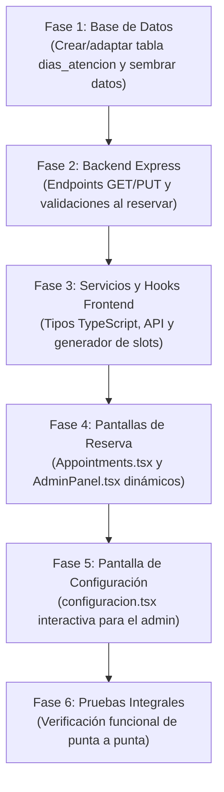

# Plan de Implementación: Turnos Configurables por Día

**Proyecto:** Mundo Peludo (Veterinaria)  
**Documento base:** [`docs/especificacion-turnos-configurables.md`](file:///c:/Users/lujan/Desktop/MundoPeludo/docs/especificacion-turnos-configurables.md)  
**Fecha:** 25 de Octubre de 2026  
**Ubicación:** `docs/plan-implementacion-turnos.md`  

---

## 1. Visión General del Plan

Este plan está estructurado de forma **incremental y pedagógica**: cada fase resuelve una capa del sistema (Base de Datos ➔ Backend ➔ Frontend Lógica ➔ Frontend Vistas) y cuenta con su respectivo método de verificación antes de pasar a la siguiente. De esta forma, el aprendizaje es guiado, seguro y sin sobre-ingeniería.



---

## 2. Fases de Implementación

---

### Fase 1: Base de Datos (MySQL)

#### Objetivo
Garantizar que la tabla `dias_atencion` contenga exactamente los 7 días de la semana (del domingo `0` al sábado `6`) con sus columnas de estado y horario corrido.

#### Archivos involucrados
- Script SQL para ejecutar en phpMyAdmin (o consola MySQL de XAMPP).

#### Tareas a realizar
- [ ] **1.1 Crear o reestructurar la tabla `dias_atencion`:**
  ```sql
  CREATE TABLE IF NOT EXISTS dias_atencion (
    id INT AUTO_INCREMENT PRIMARY KEY,
    numero_dia TINYINT NOT NULL UNIQUE COMMENT '0: Domingo, 1: Lunes, ..., 6: Sábado',
    nombre_dia VARCHAR(15) NOT NULL,
    activo TINYINT(1) NOT NULL DEFAULT 1 COMMENT '1: atiende, 0: cerrado',
    hora_inicio TIME NULL COMMENT 'Apertura de corrido',
    hora_fin TIME NULL COMMENT 'Cierre de corrido',
    intervalo_minutos INT NOT NULL DEFAULT 30
  );
  ```

- [ ] **1.2 Insertar / Actualizar los 7 días por defecto:**
  ```sql
  INSERT INTO dias_atencion (numero_dia, nombre_dia, activo, hora_inicio, hora_fin, intervalo_minutos)
  VALUES
    (0, 'Domingo',   0, NULL,       NULL,       30),
    (1, 'Lunes',     1, '09:00:00', '20:00:00', 30),
    (2, 'Martes',    1, '09:00:00', '20:00:00', 30),
    (3, 'Miércoles', 1, '09:00:00', '20:00:00', 30),
    (4, 'Jueves',    1, '09:00:00', '20:00:00', 30),
    (5, 'Viernes',   1, '09:00:00', '20:00:00', 30),
    (6, 'Sábado',    1, '09:00:00', '13:00:00', 30)
  ON DUPLICATE KEY UPDATE
    nombre_dia = VALUES(nombre_dia),
    activo = VALUES(activo),
    hora_inicio = VALUES(hora_inicio),
    hora_fin = VALUES(hora_fin),
    intervalo_minutos = VALUES(intervalo_minutos);
  ```

#### Verificación de la Fase 1
Ejecutar en MySQL:
```sql
SELECT * FROM dias_atencion ORDER BY numero_dia ASC;
```
Debe devolver 7 filas. El domingo con `activo = 0`, lunes a viernes de 09:00 a 20:00, y sábado de 09:00 a 13:00.

---

### Fase 2: Backend (`MundoPeludoB/server.js`)

#### Objetivo
1. Proveer la API para que el frontend lea y actualice la configuración.
2. Validar en el servidor que nadie pueda reservar un turno en un día cerrado ni fuera del horario de ese día.

#### Archivos involucrados
- [`MundoPeludoB/server.js`](file:///c:/Users/lujan/Desktop/MundoPeludo/MundoPeludoB/server.js)

#### Tareas a realizar
- [ ] **2.1 Asegurar endpoint `GET /api/dias-atencion`:**
  Verificar que devuelva los 7 días ordenados por `numero_dia ASC`:
  ```js
  app.get('/api/dias-atencion', async (_req, res) => {
    try {
      const [rows] = await db.promise().query('SELECT * FROM dias_atencion ORDER BY numero_dia ASC');
      res.json(rows);
    } catch (e) {
      console.error(e);
      res.status(500).json({ error: 'Error al consultar días de atención' });
    }
  });
  ```

- [ ] **2.2 Crear endpoint `PUT /api/dias-atencion`:**
  Permite actualizar la lista completa de días desde la pantalla de configuración:
  ```js
  app.put('/api/dias-atencion', async (req, res) => {
    const dias = req.body;
    if (!Array.isArray(dias) || dias.length === 0) {
      return res.status(400).json({ error: 'Formato de días inválido' });
    }
    const conn = db.promise();
    try {
      await conn.beginTransaction();
      for (const d of dias) {
        await conn.query(
          `UPDATE dias_atencion 
           SET activo = ?, hora_inicio = ?, hora_fin = ?, intervalo_minutos = ? 
           WHERE numero_dia = ?`,
          [
            d.activo ? 1 : 0,
            d.hora_inicio || null,
            d.hora_fin || null,
            Number(d.intervalo_minutos) || 30,
            d.numero_dia
          ]
        );
      }
      await conn.commit();
      res.json({ ok: true, mensaje: 'Horarios actualizados exitosamente' });
    } catch (e) {
      await conn.rollback();
      console.error(e);
      res.status(500).json({ error: 'No se pudieron actualizar los horarios de atención' });
    }
  });
  ```

- [ ] **2.3 Agregar validación en `POST /api/turnos` y en reprogramación:**
  Antes de insertar o reprogramar un turno con `{ fecha, hora }`:
  ```js
  // 1. Obtener día de la semana (0: Domingo ... 6: Sábado)
  const diaSemana = new Date(`${fecha}T00:00:00`).getDay();

  // 2. Consultar configuración de ese día
  const [configDia] = await conn.query(
    'SELECT activo, hora_inicio, hora_fin FROM dias_atencion WHERE numero_dia = ?',
    [diaSemana]
  );

  if (!configDia.length || !configDia[0].activo) {
    await conn.rollback();
    return res.status(400).json({ error: 'La veterinaria no atiende en el día seleccionado' });
  }

  // 3. Validar rango horario
  const { hora_inicio, hora_fin } = configDia[0];
  const horaTurnoMin = Number(hora.slice(0, 2)) * 60 + Number(hora.slice(3, 5));
  const [hIni, mIni] = hora_inicio.slice(0, 5).split(':').map(Number);
  const [hFin, mFin] = hora_fin.slice(0, 5).split(':').map(Number);
  const rangoIniMin = hIni * 60 + mIni;
  const rangoFinMin = hFin * 60 + mFin;

  if (horaTurnoMin < rangoIniMin || horaTurnoMin + duration > rangoFinMin) {
    await conn.rollback();
    return res.status(400).json({ error: 'El horario seleccionado está fuera del rango de atención de este día' });
  }
  ```

#### Verificación de la Fase 2
1. Hacer un `GET http://localhost:3000/api/dias-atencion` y comprobar que devuelve los 7 días.
2. Probar un `POST http://localhost:3000/api/turnos` con fecha de un domingo: el servidor debe responder HTTP 400 rechazando el turno.
3. Probar un `POST` para un sábado a las 18:00: el servidor debe rechazarlo con HTTP 400 porque los sábados cierran a las 13:00.

---

### Fase 3: Servicios y Lógica en Frontend (`MundoPeludoF`)

#### Objetivo
Centralizar la comunicación con la API y crear la función pura para generar los horarios disponibles de cualquier día.

#### Archivos involucrados
- [`MundoPeludoF/src/service/api.ts`](file:///c:/Users/lujan/Desktop/MundoPeludo/MundoPeludoF/src/service/api.ts)
- [`MundoPeludoF/src/app/hooks/useTurnos.ts`](file:///c:/Users/lujan/Desktop/MundoPeludo/MundoPeludoF/src/app/hooks/useTurnos.ts)

#### Tareas a realizar
- [ ] **3.1 Tipado y función de actualización en `api.ts`:**
  ```ts
  export interface DiaAtencion {
    id?: number;
    numero_dia: number; // 0 a 6
    nombre_dia: string;
    activo: number | boolean;
    hora_inicio: string | null; // "09:00:00"
    hora_fin: string | null;    // "20:00:00"
    intervalo_minutos: number;  // 30
  }

  export const actualizarDiasAtencion = async (dias: DiaAtencion[]) => {
    const response = await fetch('http://localhost:3000/api/dias-atencion', {
      method: 'PUT',
      headers: { 'Content-Type': 'application/json' },
      body: JSON.stringify(dias),
    });
    if (!response.ok) throw new Error('Error al actualizar días de atención');
    return await response.json();
  };
  ```

- [ ] **3.2 Función `generarSlotsDelDia` en `useTurnos.ts`:**
  ```ts
  export function generarSlotsDelDia(
    configDia?: DiaAtencion,
    duracionServicio: number = 30
  ): string[] {
    if (!configDia || !configDia.activo || !configDia.hora_inicio || !configDia.hora_fin) return [];

    const slots: string[] = [];
    const [hIni, mIni] = configDia.hora_inicio.slice(0, 5).split(':').map(Number);
    const [hFin, mFin] = configDia.hora_fin.slice(0, 5).split(':').map(Number);
    const iniMin = hIni * 60 + mIni;
    const finMin = hFin * 60 + mFin;
    const paso = configDia.intervalo_minutos || 30;

    for (let min = iniMin; min + duracionServicio <= finMin; min += paso) {
      const hh = String(Math.floor(min / 60)).padStart(2, '0');
      const mm = String(min % 60).padStart(2, '0');
      slots.push(`${hh}:${mm}`);
    }

    return slots;
  }
  ```

#### Verificación de la Fase 3
Llamar a `generarSlotsDelDia({ activo: 1, hora_inicio: '09:00', hora_fin: '13:00', intervalo_minutos: 30 })`:
Debe retornar exactamente: `['09:00', '09:30', '10:00', '10:30', '11:00', '11:30', '12:00', '12:30']`.

---

### Fase 4: Pantallas de Turnos (`Appointments.tsx` y `AdminPanel.tsx`)

#### Objetivo
Conectar el calendario y los botones de horarios con la configuración dinámica de la base de datos.

#### Archivos involucrados
- [`MundoPeludoF/src/app/components/Appointments.tsx`](file:///c:/Users/lujan/Desktop/MundoPeludo/MundoPeludoF/src/app/components/Appointments.tsx)
- [`MundoPeludoF/src/app/components/AdminPanel.tsx`](file:///c:/Users/lujan/Desktop/MundoPeludo/MundoPeludoF/src/app/components/AdminPanel.tsx)

#### Tareas a realizar
- [ ] **4.1 Actualizar `Appointments.tsx`:**
  1. Cargar `diasAtencion` mediante un `useEffect` usando `obtenerDiasAtencion()`.
  2. Modificar `isDateAvailable(day)`:
     ```ts
     const d = new Date(currentMonth.getFullYear(), currentMonth.getMonth(), day);
     const numDia = d.getDay();
     const config = diasAtencion.find(da => da.numero_dia === numDia);
     const diaHabilitado = config ? Boolean(config.activo) : false;

     return d >= today && d <= twoMonthsLater && !esFeriado(d) && diaHabilitado;
     ```
  3. Modificar `getTimeSlots()` para no usar una lista estática:
     ```ts
     // Obtener el día de la semana de la fecha seleccionada
     const numDia = fechaSeleccionadaDate.getDay();
     const configDia = diasAtencion.find(da => da.numero_dia === numDia);
     const duracion = selected ? Number(selected.duracion_minutos) : 30;
     const slots = generarSlotsDelDia(configDia, duracion);
     // Evaluar disponibilidad cruzando con slotAvailable
     ```

- [ ] **4.2 Actualizar pestaña Turnos en `AdminPanel.tsx`:**
  - Aplicar la misma validación de calendario y generación de slots para que el administrador vea los mismos horarios reales que el cliente.

#### Verificación de la Fase 4
1. Entrar a `/turnos`.
2. Verificar que los domingos se ven en gris y no se pueden cliquear.
3. Cliquear un lunes: deben verse horarios de corrido desde las 09:00 hasta las 19:30.
4. Cliquear un sábado: solo deben verse horarios desde las 09:00 hasta las 12:30.

---

### Fase 5: Pantalla de Configuración (`configuracion.tsx`)

#### Objetivo
Permitir que el administrador modifique los días de atención y sus horarios desde una interfaz gráfica clara y guarde los cambios en la base de datos.

#### Archivos involucrados
- [`MundoPeludoF/src/app/components/configuracion.tsx`](file:///c:/Users/lujan/Desktop/MundoPeludo/MundoPeludoF/src/app/components/configuracion.tsx)

#### Tareas a realizar
- [ ] **5.1 Construir la sección "Días y Horarios de Atención" en `configuracion.tsx`:**
  - Estado local `dias: DiaAtencion[]` cargado con `obtenerDiasAtencion()`.
  - Tabla o lista de 7 filas (Lunes a Domingo):
    - Columna 1: Nombre del día.
    - Columna 2: Checkbox o Switch "Abierto / Atiende".
    - Columna 3: Input `type="time"` para `hora_inicio` (deshabilitado si `activo` es falso).
    - Columna 4: Input `type="time"` para `hora_fin` (deshabilitado si `activo` es falso).
    - Columna 5: Input número para `intervalo_minutos` (ej. 30).
  - Botón: "Guardar Horarios" con mensaje de éxito o error tras la llamada a `actualizarDiasAtencion(dias)`.

#### Verificación de la Fase 5
1. Ir a `/configuracion` en el navegador.
2. Modificar el horario del sábado para que cierre a las 14:00 (en vez de 13:00) y pulsar "Guardar".
3. Volver a `/turnos`, cliquear un sábado y comprobar que ahora el slot de las 13:00 y 13:30 aparecen disponibles.
4. Activar el domingo en `/configuracion` de 10:00 a 13:00, guardar, y comprobar que en `/turnos` el domingo ahora está habilitado en el calendario.

---

### Fase 6: Pruebas Integrales y Verificación Final

#### Matriz de Pruebas
| Caso de Prueba | Acción Realizada | Resultado Esperado |
|:---|:---|:---|
| **CP-01: Horario de corrido lunes** | Seleccionar un lunes en `/turnos` | Se listan horarios desde 09:00 hasta 19:30 ininterrumpidos. |
| **CP-02: Horario matutino sábado** | Seleccionar un sábado en `/turnos` | Se listan horarios solo de 09:00 a 12:30. |
| **CP-03: Domingo cerrado por defecto** | Observar cualquier domingo en el calendario | El día está deshabilitado en gris, no permite clic. |
| **CP-04: Reserva exitosa en día hábil** | Reservar un turno un martes a las 15:00 | Se guarda en la BD y el slot pasa a estado "ocupado" (gris). |
| **CP-05: Modificación de horario** | Cambiar en `/configuracion` el cierre de viernes a las 17:00 | Al volver a `/turnos`, el viernes no muestra horarios posteriores a las 16:30. |
| **CP-06: Habilitación de domingo** | Activar domingo en `/configuracion` con horario 09:00 a 12:00 | El domingo se habilita en el calendario y muestra turnos matutinos. |
| **CP-07: Seguridad backend** | Enviar petición POST forzada fuera de horario | El servidor responde HTTP 400 y no guarda el registro en la BD. |

---

## 3. Estado de Ejecución

- [ ] Fase 1: Base de Datos (MySQL)
- [ ] Fase 2: Backend (`MundoPeludoB/server.js`)
- [ ] Fase 3: Servicios y Lógica Frontend (`api.ts` y `useTurnos.ts`)
- [ ] Fase 4: Vistas de Reserva (`Appointments.tsx` y `AdminPanel.tsx`)
- [ ] Fase 5: Pantalla de Configuración (`configuracion.tsx`)
- [ ] Fase 6: Pruebas Integrales

